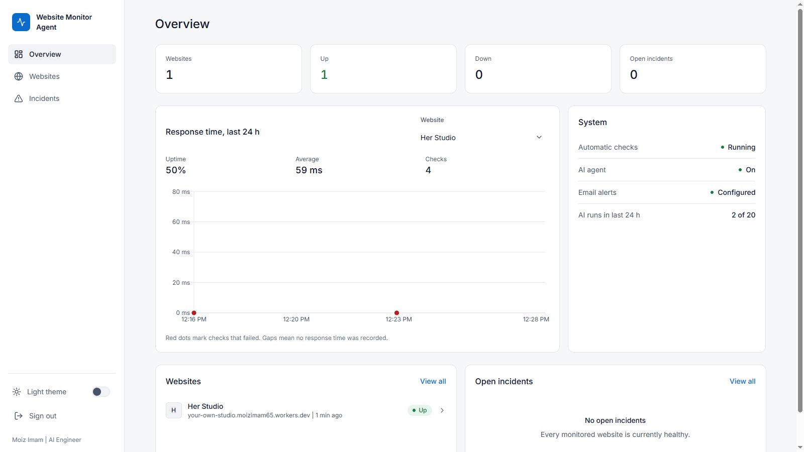
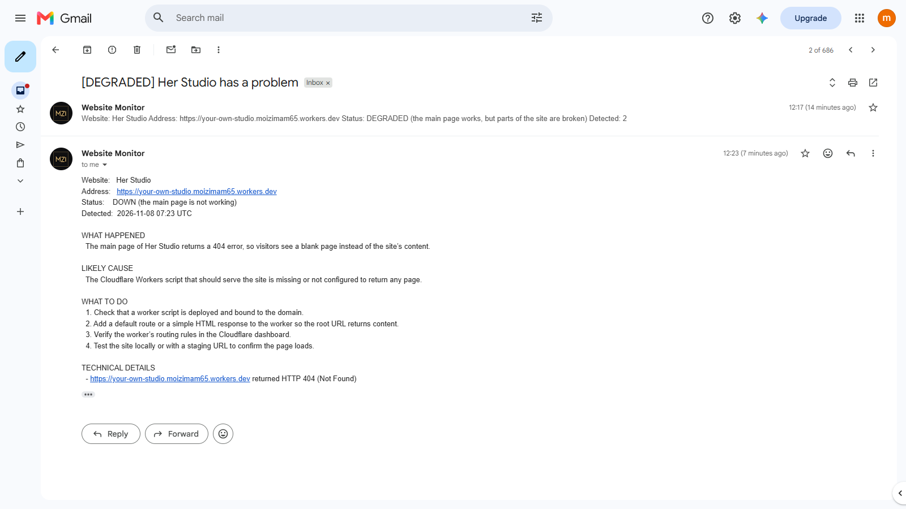

# Website Monitor Agent

An AI agent that watches your website around the clock. When something breaks, it works out why, writes a plain-language report, and emails the owner. When the site comes back, it tells them that too.

**Live demo:** https://website-monitor-agent-a2290.containers.snapdeploy.app
The demo runs on a free host that sleeps when idle, so the first load can take about a minute. Demo access is available on request: [moizimamburiro@gmail.com].



## Why I built it

Most small business owners find out their website is down from a customer, not from a tool. Uptime monitors exist, but they usually say only "down" and leave the owner to guess why. I wanted to see how far an agent could go in the other direction: not just detect the problem, but investigate it and explain it to someone who is not a developer.

## What it does

- Checks each website on a schedule (every 5 minutes or slower): the main page, extra pages, API endpoints, images, the SSL certificate and DNS.
- Confirms every failure with a second check before believing it, so one network blip is not an incident.
- When something is really wrong, a LangChain agent investigates with read-only tools and writes a report: what happened, the likely cause, and what to do about it.
- Emails the owner once per incident, then sends a recovery email when it is fixed.
- Shows everything in a dashboard: website status, incidents with the AI analysis, a response-time chart, uptime, and light and dark themes.



## How it works

```
Scheduler (every minute)
   -> plain Python checks: pages, APIs, images, SSL, DNS
   -> everything fine? save the result and stop
   -> problem found? confirm with a second check
        -> LangChain agent investigates with 6 read-only tools
        -> structured report: summary, likely cause, severity, next steps
        -> email alert (and a recovery email later)
   -> results and incidents saved in the database
FastAPI serves the dashboard and the API
```

The AI is only a small part of the system. Most of the work is ordinary, testable Python, and the agent is called only when there is something to explain.

## Design decisions

- **The AI runs only when something breaks.** Checking a site every few minutes with an LLM would be slow and expensive. Plain code does the checking, and the agent handles the unusual cases.
- **One email per incident.** A site that stays down does not send a message every five minutes. A limit of 3 alert emails per site per hour stops a flapping site from flooding the inbox, but a new problem after a recovery is always reported.
- **The agent is read-only.** Its tools can only look at the monitored site, and none of them can send email or change anything. The code sends the email, not the model. Text from the websites is treated as untrusted data.
- **It never depends on the AI to work.** If the model fails, times out or returns bad output, the owner still gets a clear alert built from the raw findings. AI-written explanations are labeled as such.
- **Cost control.** There is a daily cap on agent runs, and each incident is analysed once.
- **Safe by default.** Addresses that point to private or local networks are refused, redirects are checked at every hop, and the dashboard sits behind a password.

## Tech stack

| Area | Tools |
|---|---|
| Backend | Python, FastAPI, SQLModel, APScheduler |
| Agent | LangChain, Groq (`openai/gpt-oss-20b`) |
| Frontend | React, TypeScript, Tailwind CSS, Recharts | Frontend is made by AI tool 
| Database | SQLite locally, PostgreSQL (Neon) when hosted |
| Email | Gmail SMTP, with an HTTPS option through Brevo |
| Tests | pytest |
| Deployment | Docker |

## Project structure

```
backend/
  app/
    api/routes/     web endpoints (auth, monitors, incidents, agent status)
    core/           settings, login security, limits
    db/             database models and session
    schemas/        what the API accepts and returns
    services/       business logic: checks, incidents, alerts, stats
    monitoring/     the checks, URL safety guard, scheduler
    agent/          tools, prompts, report format, agent runner
  tests/            automated tests
  static/           built dashboard (served by FastAPI)
frontend/           React dashboard source 
```

## Run it locally

You need Python 3.13, Node.js, a Groq API key, and a Gmail account with an app password for sending alerts.

```bash
git clone [https://github.com/moiz-imam-buriro/website-monitor-agent.git]
cd [backend]

python -m venv .venv
# Windows: .venv\Scripts\activate    macOS/Linux: source .venv/bin/activate
pip install -r backend/requirements.txt

cp .env.example .env     # then fill in your values

cd frontend
npm install
npm run build
cp -r dist/* ../backend/static/     # Windows PowerShell: Copy-Item -Recurse dist\* ..\backend\static\

cd ../backend
uvicorn app.main:app --port 8000
```

Open http://localhost:8000 and sign in with the `ADMIN_PASSWORD` you set.

### Settings

| Variable | Purpose |
|---|---|
| `ADMIN_PASSWORD` | Password for the dashboard |
| `JWT_SECRET` | Random secret that signs login sessions |
| `GROQ_API_KEY`, `LLM_MODEL` | The model used by the agent |
| `SMTP_USER`, `SMTP_PASSWORD`, `SMTP_FROM`, `SMTP_FROM_NAME` | Email sending |
| `DATABASE_URL` | Optional. A Postgres address; SQLite is used if empty |
| `MAX_AGENT_RUNS_PER_DAY` | Daily cap on AI investigations (default 20) |
| `ALLOW_PRIVATE_TARGETS` | Keep `false` on any public server |
| `CORS_ORIGINS` | Dashboard addresses allowed to call the API |
| `BREVO_API_KEY`, `BREVO_SENDER_EMAIL` | Optional. Send email over HTTPS instead of SMTP |

## API at a glance

| Route | What it does |
|---|---|
| `POST /auth/login` | Sign in and get a token |
| `GET, POST /monitors` | List and add websites |
| `PATCH, DELETE /monitors/{id}` | Edit, pause, or remove a website |
| `GET /monitors/{id}/checks` | Check history, uptime, response times |
| `POST /monitors/{id}/check-now` | Run a check immediately |
| `POST /monitors/{id}/test-email` | Send a test alert |
| `GET /incidents` | Incidents, filtered by status or website |
| `GET /agent/status` | Engine, AI and email status, counts |

Interactive docs are available at `/docs` when the server is running.

## Tests

```bash
cd backend
python -m pytest tests -q
```

The suite has more than 130 tests. The website checks run against a fake web server, and the AI and email parts are replaced with stand-ins, so the tests need no internet and make no real API calls.

## Deployment notes

The project includes a Dockerfile in `backend/`. The scheduler runs inside the app, so run a single worker. On free hosting that sleeps when idle, monitoring pauses while the app is asleep. For round-the-clock monitoring, run it on a small always-on server.

## Limitations and next steps

- Built for a single owner. There are no user accounts.
- A network outage on the monitoring server could look like a site outage. A connectivity check before alerting is planned.
- Alerts go out by email only. Telegram is the next channel I would add.
- The agent explains problems but never fixes them, by design.

## Author

Built by **Moiz Imam | AI Engineer**
[moizimamburiro@gmail.com]
